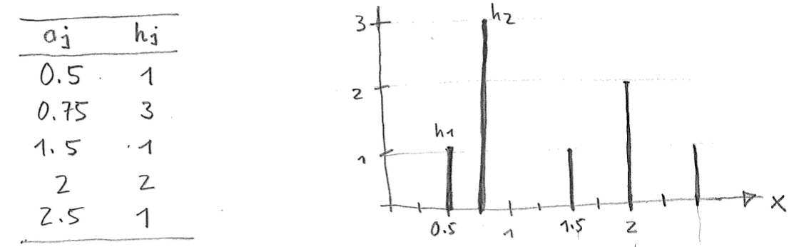
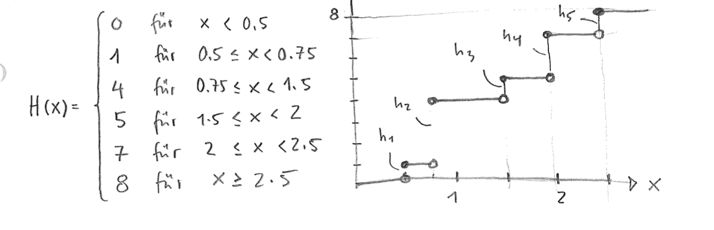

::: {#exr-hauefigkeitsverteilung}
## Häufigkeitsverteilung

Wir betrachten den Datensatz

$$
  0.5, 1.75, 0.5, 2.5, 0.5, 1.75, 2, 1.5.
$$

Aufgaben: 

1. Skizzieren Sie das Stabdiagramm der absoluten Häufigkeitsverteilung.
1. Wie lautet die Zuordnungsvorschrift der Funktion $H : \mathbb{R} \to \mathbb{N}$, die zu jeder Zahl $x$ angibt, wie viele der Werte aus dem Datensatz kleiner oder gleich $x$ sind. Skizzieren Sie den Graphen von $H$.

::: {.tinh-solution}
1. Stabdiagramm

   

1. Funktion $H$

   
:::
:::
