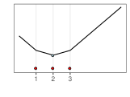
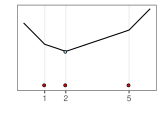
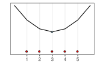
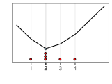
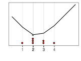
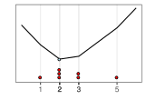
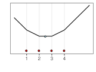
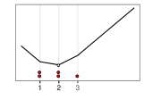
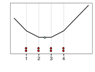
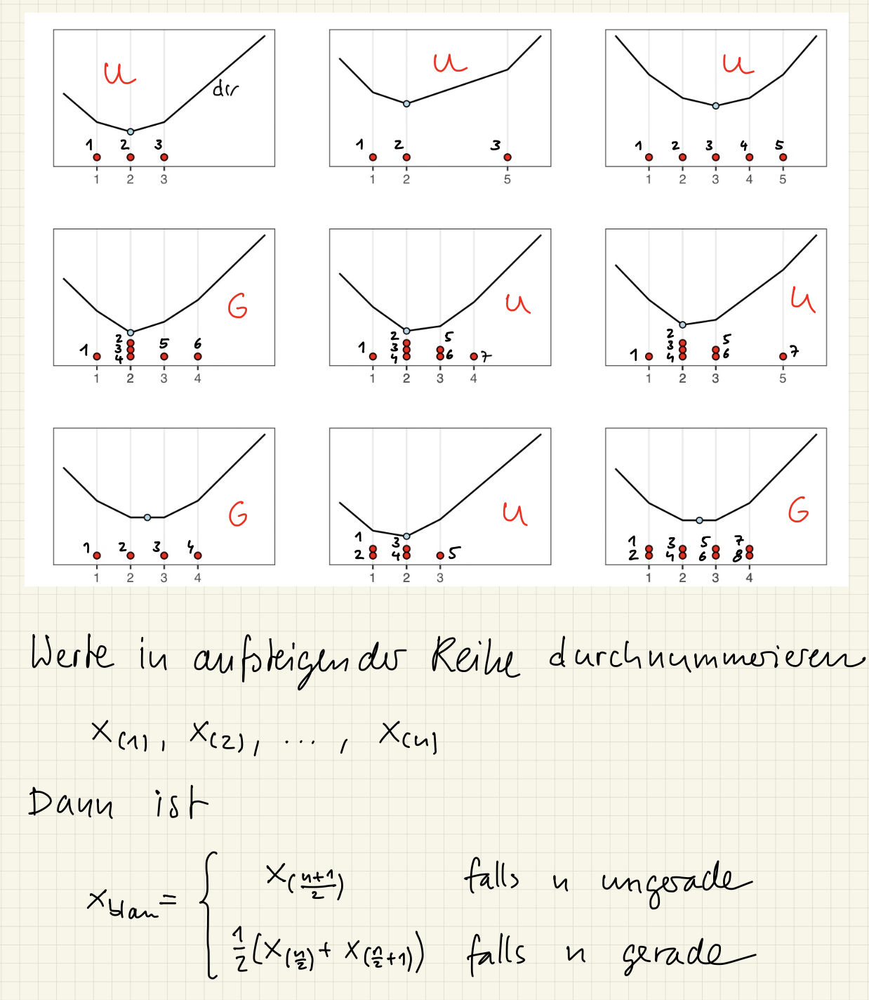

::: {#exr-median}
## Median

Geben Sie eine Vorschrift zur Bestimmung der $x$-Koordinate des blauen Punktes an. Tipp: Es hilft, die roten Punkte durchzunummerieren.

::: {layout-ncol=3}

{}

{}

{}

{}

{}

{}

{}

{}

{}

:::

::: {.lm-solution}

:::
:::
