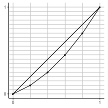
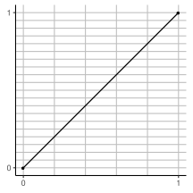
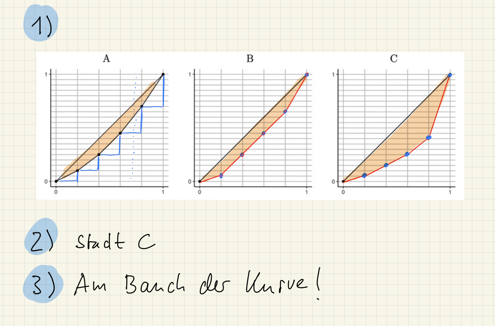

::: {#exr-lorenzkurve}
## Lorenzkurve

In den drei Städten A, B und C teilen sich Bauleistungen auf jeweils fünf Firmen wie folgt auf (in 100000 Euro):

```{r}
#| echo: false
#| warning: false

library(tidyverse)
library(gt)

d <- tibble(
  Stadt = c("A", "B", "C"),
  `1` = c(6, 4, 2),
  `2` = c(5, 7, 1),
  `3` = c(4, 4, 3),
  `4` = c(3, 4, 2),
  `5` = c(2, 1, 12)
)

gt(d) |>
  cols_align("center") |>
  tab_spanner(label = "Baufirma", columns = -Stadt)
```

Aufgaben:

1.  Wie ist die Kurve zu Stadt A entstanden? Ergänzen Sie nach demselben Prinzip die Diagramme für die Städte B und C.
1.  In welcher Stadt ist der Markt am stärksten bei einer Firma konzentriert?
1.  Wie können Sie das an den Kurven ablesen?

::: {layout-ncol="3"}





:::

::: {.tinh-solution}

:::
:::
