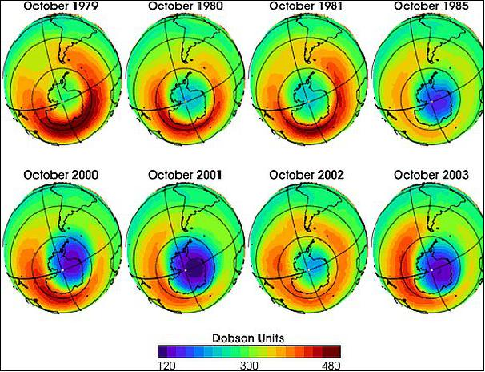

```{r}
#| cache: false
#| include: false
source(rprojroot::has_file("_bcd-setup.R")$find_file("_bcd-setup.R"))
withr::with_dir("../skript", source("01-daten/kenngroessen.R"))

d_streuung <- d_ns_bo_2008_2010_monat |>
  group_by(Jahr) |>
  summarise(
    Mittelwert = mean(Niederschlag),
    Varianz = mean((Niederschlag - Mittelwert)^2),
    Standardabweichung = sqrt(Varianz),
    Variationskoeffizient = Standardabweichung / Mittelwert,
    Stichprobenvarianz = var(Niederschlag)
  )

kg <- function(d, v, i, digits = 2) {
  format(round(pluck(d, v, i), digits), nsmall = digits)
}

tab_monate <- function(d) {
  d |>
    mutate(Niederschlag = round(Niederschlag, 2)) |>
    pivot_wider(names_from = Monat, values_from = Niederschlag) |>
    tt()
}
```

## Inhalt

[]{.down50}

- Lagemaße

- Maße der Variabilität

- Quantile und Box-Plots

- Konzentrationsmaß: Der Gini-Koeffizient

# Lagemaße

## Lagemaß: Ein Maß für das Zentrum

[]{.down20}

### Was ist ein Lagemaß?

Maßzahl, die das Zentrum einer Verteilung beschreibt

. . .

[]{.down20}

### Eigenschaften

- Liegt zwischen dem kleinsten und dem größten Wert

- Sind alle Werte gleich, ist das Lagemaß gleich diesem Wert

- Hat dieselbe Einheit wie die Werte

## Arithmetisches Mittel

[]{.down40}

::: {#def-arithmetisches-mittel}
Für die $n$ Zahlen $x_1, x_2, \dots, x_n$ wird der Wert
$$
\bar{x} = \frac{1}{n}\left(x_1 + x_2 + \dots + x_n\right) = \frac{1}{n} \sum_{i=1}^n x_i
$$
[arithmetisches Mittel]{.neuerbegriff} oder kurz [Mittelwert]{.neuerbegriff} genannt.
:::

. . .

[]{.down20}

::: {#exm-arithmetisches-mittel}
## Arithmetisches Mittel

Für die Zahlen $x_1 = 2$, $x_2 = 3$, $x_3 = 7$ ist $\bar{x} = \frac{1}{3}(2 + 3 + 7) = 4$
:::

## Eigenschaften des arithmetischen Mittels

[]{.down30}

1. Der Wert $\bar{x}$ minimiert die Summe der quadrierten Abstände
   ```{=typst}
   $ macron(x) = op("argmin", limits: #true)_a sum_(i=1)^n (x_i - a)^2 $
   ```

. . .

1. An eine gewichtslose Stange wird für jeden Wert $x_i$ eine Kugel gehängt. Wenn die Stange bei $\bar{x}$ gelagert wird, ist das System im statischen Gleichgewicht.

```{r}
#| fig-asp: 0.2
p_mittelwert_schwerpunkt()
```

## 

[]{.up40}

::: {#exm-arithmetisches-mittel-einzelner-wert}
## Änderung eines einzelnen Werts

[]{.up10}

```{r}
#| fig-asp: 0.525
p1 <- p_mittelwert(d_bsp_mittelwert, X)
p2 <- p_mittelwert(d_bsp_mittelwert, Y)
p1 / p2 + plot_layout(axes = "collect")
```

[]{.up20}

→ Arithmetisches Mittel durch einen einzelnen Wert stark beeinflusst
:::

## Ausreißer und Robustheit

[]{.down10}

### Ausreißer

- Der einzelne Wert fällt aus dem Wertebereich der anderen Beobachtungen heraus
- Eine solche extreme Beobachtung heißt [Ausreißer]{.neuerbegriff}
- Kann eine wichtige Information sein, aber auch ein Übertragungs- oder Messfehler
- Ob ein Ausreißer ein extremer, aber richtiger Wert oder ein Fehler ist, muss im Einzelfall sorgfältig geprüft werden

. . .

[]{.down10}

### Empfindliche und robuste Lagemaße

- Das arithmetische Mittel ist gegenüber Ausreißern sehr empfindlich. Einzelne fehlerhafte Werte können den Mittelwert stark verfälschen
- Gegenüber Extremwerten wenig anfällige Lagemaße heißen [resistent]{.neuerbegriff} oder [robust]{.neuerbegriff}

## Die Entdeckung des Ozonlochs

::: {.columns}
::: {.column width=30%}
{width="6cm"}
{width="6cm"}
:::
::: {.column width=62%}
Vom Wettersatelliten Nimbus 7 wurden seit November 1978 extrem geringe Ozonwerte über der Antarktis gemeldet. Bei der automatischen Auswertung wurden diese Werte als Messfehler ausgesondert. Erst 1984 belegten Forschungsstationen das Ozonloch durch Beobachtungen. Eine Neuauswertung der Satellitendaten zeigte dann das gesamte Ausmaß [@ludwig2006]

. . .

Anmerkung: In Wirklichkeit war es wohl komplizierter, siehe [@pukelsheim1990]
:::
:::

## Median als robustes Lagemaß

Zuerst: Urliste $x_1, x_2, \dots, x_n$ zur [geordneten Urliste]{.neuerbegriff} $x_{(1)}, x_{(2)}, \dots, x_{(n)}$ umsortieren, so dass $x_{(1)} \leq x_{(2)} \leq \dots \leq x_{(i)} \leq \dots \leq x_{(n)}$

[]{.down10}

. . .

::: {#def-median}
Der [Median]{.neuerbegriff} $x_\mathrm{med}$ einer geordneten Urliste $x_{(1)}, \dots, x_{(n)}$ ist
```{=typst}
$ x_"med" = cases(
  x_(((n+1)/2)) & "für ungerades" n,
  1/2 (x_((n/2)) + x_((n/2 + 1))) & "für gerades" n,
  gap: #1em
). $
```
:::

[]{.down10}

. . .

### Anwendbar für

- Metrische Merkmale mit der Definition oben

- Ordinalskalierte Merkmale, Median gegebenenfalls zwischen zwei Ausprägungen

## Beispiel: Median

[]{.down50}
[]{.down50}

### → iPad

## Eigenschaften des Medians

[]{.down10}

1. Für den Median gilt:

    - mindestens 50% der Werte sind größer gleich $x_\mathrm{med}$

    - mindestens 50% sind kleiner gleich $x_\mathrm{med}$

1. Der Median minimiert die Summe der Beträge der Abstände

   ```{=typst}
   $ x_"med" = op("argmin", limits: #true)_a sum_(i=1)^n |x_i - a| $
   ```

. . .

[]{.down10}

### Warum robust? 

1. Median hängt nur von der Reihenfolge ab, nicht von der Größe der äußeren Werte

1. Große Abweichungen zählen in $\sum |x_i - a|$ weniger als in $\sum (x_i - a)^2$

## Modus

[]{.down20}

::: {#def-modus}
Der [Modus]{.neuerbegriff} $x_\mathrm{mod}$ ist diejenige Ausprägung eines Merkmals, die am häufigsten vorkommt. Der Modus ist nur dann eindeutig bestimmt, wenn die Verteilung ein eindeutiges Maximum besitzt.
:::

[]{.down20}

- Lässt sich für alle Arten von Merkmalen bestimmen, auch für nominalskalierte

- Im Säulendiagramm die Ausprägung mit der höchsten Säule

## Geometrisches Mittel

::: {#def-geometrisches-mittel}
Das [geometrische Mittel]{.neuerbegriff} zu den positiven Faktoren $x_1, x_2, \dots, x_n$ ist die $n$-te Wurzel aus dem Produkt der Faktoren, also

$$
\bar{x}_\mathrm{geom} = \sqrt[n]{x_1 \cdot x_2 \cdot \dots \cdot x_n}.
$$
:::

. . .

[]{.down20}

### Zusammenhang 

Für Bestand $B_0, B_1, \dots, B_n$ mit Wachstumsfaktoren $x_i = B_i / B_{i-1}$ gilt

[]{.down10}

$$
B_n 
= 
x_1 \cdot x_2 \cdot \dots \cdot x_n \cdot B_0 
= 
\underbrace{\bar{x}_\mathrm{geom} \cdot \bar{x}_\mathrm{geom} \cdot \dots \cdot \bar{x}_\mathrm{geom}}_{n\ \mathrm{mal}} \cdot B_0 
=
\left(\bar{x}_\mathrm{geom}\right)^{n} \cdot B_0
$$

→ Wachstumsfaktor $\bar{x}_\mathrm{geom}$ ergibt $n$-mal angewendet dasselbe Ergebnis $B_n$

## Beispiel: Geometrisches Mittel

[]{.down50}
[]{.down50}

### → iPad

## Harmonisches Mittel

[]{.down20}

::: {#def-harmonisches-mittel}
Für die positiven Werte $x_1, \dots, x_n$ heißt die Zahl
$$
\bar{x}_\mathrm{har} = \frac{n}{\displaystyle \sum_{i=1}^n\frac{1}{x_i}}
$$
das [harmonische Mittel]{.neuerbegriff}.
:::

. . .

[]{.down20}

Das harmonische Mittel wird für Verhältnisgrößen verwendet, wenn die Zählergröße für alle Werte gleich ist, z. B. die mittlere Geschwindigkeit auf gleich langen Teilstrecken.

# Lageregeln

## 

[]{.up40}

::: {#exm-lageregeln}

## Mittelwert, Median und Modus für drei verschiedene Stichproben

[]{.up10}

```{r}
#| fig-asp: 0.325

p1 <- p_lageregeln(d_bsp_lageregeln, I)
p2 <- p_lageregeln(d_bsp_lageregeln, II)
p3 <- p_lageregeln(d_bsp_lageregeln, III)
p1 +
  p2 +
  p3 +
  plot_layout(axes = "collect", guides = "collect") &
  theme(plot.title = element_text(size = 12))
```

[]{.down10}

```{r}
d_bsp_lageregeln |>
  pivot_longer(-a, names_to = "Stichprobe", values_to = "n") |>
  uncount(n) |>
  summarise(
    `$macron(x)$` = mean(a),
    `$x_"med"$` = median(a),
    `$x_"mod"$` = modes(a),
    .by = Stichprobe
  ) |>
  mutate(
    `Form der Verteilung` = c("linkssteil", "symmetrisch", "rechtssteil"),
    `Lagemaße` = c(
      '$macron(x) > x_"med" > x_"mod"$',
      '$macron(x) = x_"med" = x_"mod"$',
      '$macron(x) < x_"med" < x_"mod"$'
    )
  ) |>
  tt(width = c(15, 6, 6, 6, 22, 22) / 100, height = 1.8) |>
  format_tt(j = 2, digits = 2, num_fmt = "decimal", num_zero = TRUE) |>
  style_tt(align = "c", alignv = "m")
```

:::

## Verallgemeinerung: Lageregeln

### Für eine unimodale Verteilung gilt meistens

|             |        |                                                         |
|------------:|:------:|:--------------------------------------------------------|
| linkssteil  | $\iff$ | $\bar{x} > x_\mathrm{med} > x_\mathrm{mod}$             |
| symmetrisch | $\iff$ | $\bar{x} \approx x_\mathrm{med} \approx x_\mathrm{mod}$ |
| rechtssteil | $\iff$ | $\bar{x} < x_\mathrm{med} < x_\mathrm{mod}$             |

. . .

### Warum ist das so?

- Bei einer schiefen Verteilung zieht der „Hebelarm“ der flach auslaufenden Seite das arithmetische Mittel in diese Richtung

- Typischerweise liegen auf der steilen Seite des Modus weniger als die Hälfte der Werte. Der Median liegt daher bei einer schiefen Verteilung zwischen Modus und arithmetischem Mittel

- Bei einer symmetrischen Verteilung liegt der höchste Punkt in der Mitte, ebenso das arithmetische Mittel und der Median

# Maße der Variabilität

## Sommer 2010

::: {.columns}
::: {.column width=70%}
{fig-align="center"}
:::
::: {.column width=30%}
Elbe in Dresden im Juli (links) und August (rechts)
:::
:::

[]{.down20}

. . .

[So verrückt war dieser Sommer](http://www.spiegel.de/wissenschaft/natur/extremwetter-so-verrueckt-war-dieser-sommer-a-714629.html) (Spiegel Online, 30.08.2010)

*Hitzewelle, Rekordregen, Neuschnee: Der Sommer 2010 war von Extremen geprägt. Vom Deutschen Wetterdienst veröffentlichte Statistiken enthalten Rekorde in Serie – von tropischen Temperaturen bis hin zum nassesten August seit Beginn der Aufzeichnungen*

## Die Jahre 2008 und 2010 in Bochum

```{r}
p_niederschlag_monate()
```

### Arithmetische Mittelwerte

$\bar{x}_{2008} = `r kg(d_streuung, "Mittelwert", 1)`\,\mathrm{mm}$ und
$\bar{x}_{2010} = `r kg(d_streuung, "Mittelwert", 2)`\,\mathrm{mm}$
$\quad$ → Notwendig: Messung der Variabilität

## Streuungsmaß: Ein Maß für die Variabilität

[]{.down20}

### Was ist ein Streuungsmaß?

Maßzahl, die angibt, wie die Werte um das Zentrum streuen

. . .

[]{.down20}

### Eigenschaften

- Streuungsmaß gleich null $\iff$ alle Werte identisch

- Wird mit zunehmender Variabilität der Werte größer

- Kann nicht negativ werden

## Spannweite

[]{.down20}

::: {#def-spannweite}
Die [Spannweite]{.neuerbegriff} $R$ einer Stichprobe ([range]{.eng}) gibt an, wie weit der größte und der kleinste Wert auseinanderliegen:
$$
R = \max x_i - \min x_i.
$$
:::

Die Spannweite ist einfach zu berechnen, hängt aber allein von zwei Werten ab und ist daher kein robustes Maß.

. . .

[]{.down20}

::: {#exm-spannweite}
## Spannweiten der monatlichen Niederschläge in Bochum

$$
\begin{aligned}
R_{2008} & =
`r pluck(d_niederschlag_kenngroessen, "Max", 1)` - `r pluck(d_niederschlag_kenngroessen, "Min", 1)` =
`r pluck(d_niederschlag_kenngroessen, "Spannweite", 1)`\,\mathrm{mm} \\
R_{2010} & =
`r pluck(d_niederschlag_kenngroessen, "Max", 2)` - `r pluck(d_niederschlag_kenngroessen, "Min", 2)` =
`r pluck(d_niederschlag_kenngroessen, "Spannweite", 2)`\,\mathrm{mm}
\end{aligned}
$$
:::

## Grundlage für ein besseres Streuungsmaß

```{r}
p_abweichungen_mittelwert()
```

. . .

Idee: Abweichungen $x_i - \bar{x}$ aller Werte vom Mittelwert einbeziehen

## AD-Streuung

[]{.down20}

Der Mittelwert der Beträge der Abweichungen

$$
AD = \frac{1}{n} \left( |x_1 - \bar{x}| + \dots + |x_n - \bar{x}| \right) = \frac{1}{n} \cdot \sum_{i=1}^n |x_i - \bar{x}|
$$

heißt [AD-Streuung]{.neuerbegriff} ([average deviation]{.eng}).

. . .

[]{.down20}

Aber

- Beträge umständlich in der Handhabung (Fallunterscheidung)

- AD-Streuung daher eher unüblich

## Varianz und Standardabweichung

::: {#def-varianz}
Der Mittelwert der quadrierten Abweichungen

$$
\tilde{s}^2 = \frac{1}{n} \left( (x_1 - \bar{x})^2 + \dots + (x_n - \bar{x})^2 \right)
= \frac{1}{n} \cdot \sum_{i=1}^n (x_i - \bar{x})^2
$$

[]{.up5}

heißt [empirische Varianz]{.neuerbegriff}, die Wurzel

$$
\tilde{s} = \sqrt{\tilde{s}^2} = \sqrt{\frac{1}{n} \cdot \sum_{i=1}^n (x_i - \bar{x})^2}
$$

wird [empirische Standardabweichung]{.neuerbegriff} genannt.
:::

. . .

- Einheit der Varianz $\tilde{s}^2$ ist das Quadrat der Einheit des Merkmals

- Standardabweichung $\tilde{s}$ hat wieder die Einheit des Merkmals

## 

[]{.up40}

::: {#exm-varianz-bochum}

## Niederschläge in Bochum

[]{.up5}
[]{.down5}

### Empirische Varianzen

$$
\begin{aligned}
\tilde{s}^2_{2008} & = \frac{1}{12}\left(19.35^2 + (-23.55)^2 + \dots + (-28.55)^2 \right)
\approx `r kg(d_streuung, "Varianz", 1)`\,\mathrm{mm}^2 \\[1em]
\tilde{s}^2_{2010} & = \frac{1}{12}\left( (-24.45)^2 + (-0.05)^2 + \dots + 11.75^2 \right)
\approx `r kg(d_streuung, "Varianz", 2)`\,\mathrm{mm}^2
\end{aligned}
$$

### Standardabweichungen

$$
\tilde{s}_{2008} = \sqrt{`r kg(d_streuung, "Varianz", 1)`} \approx `r kg(d_streuung, "Standardabweichung", 1)`\,\mathrm{mm}
\quad \text{und} \quad
\tilde{s}_{2010} = \sqrt{`r kg(d_streuung, "Varianz", 2)`} \approx `r kg(d_streuung, "Standardabweichung", 2)`\,\mathrm{mm}
$$

### Anmerkungen

- Unterschiedliche Niederschlagscharakteristik deutlich ablesbar

- Standardabweichung im selben Wertebereich wie Merkmal
:::

## Variationskoeffizient

::: {#def-variationskoeffizient}
Für eine Stichprobe $x_1, \dots, x_n$ mit $x_i \geq 0$ und $\bar{x} > 0$ heißt die dimensionslose Zahl
$$
v = \frac{\tilde{s}}{\bar{x}}
$$
[Variationskoeffizient]{.neuerbegriff}.
:::

→ Variabilität im Verhältnis zum Mittelwert

[]{.down10}

. . .

::: {#exm-variationskoeffizient-bochum}
## Niederschläge in Bochum

$$
v_{2008} \approx \frac{`r kg(d_streuung, "Standardabweichung", 1)`}{`r kg(d_streuung, "Mittelwert", 1)`}
\approx `r kg(d_streuung, "Variationskoeffizient", 1)`
\quad \text{und} \quad
v_{2010} \approx \frac{`r kg(d_streuung, "Standardabweichung", 2)`}{`r kg(d_streuung, "Mittelwert", 2)`}
\approx `r kg(d_streuung, "Variationskoeffizient", 2)`
$$
:::

## Stichprobenvarianz

[]{.down20}

In der schließenden Statistik wird durch $n - 1$ dividiert, das ergibt die [Stichprobenvarianz]{.neuerbegriff}

$$
s^2 = \frac{1}{n - 1} \cdot \sum_{i=1}^n (x_i - \bar{x})^2
$$

Für größere Werte von $n$ ist der Unterschied zwischen $\tilde{s}^2$ und $s^2$ vernachlässigbar.

. . .

→ Werden wir später ausführlich behandeln

# Quantile und Box-Plots

## Vom Median zum Quantil

```{r}
x <- pull(d_random_sample, X)
```

. . .

[]{.down20}

### Bekannt: Median

Der Median $x_\mathrm{med}$ teilt die Stichprobe so, dass mindestens $50\%$ der Werte kleiner oder gleich $x_\mathrm{med}$ und mindestens $50\%$ größer oder gleich $x_\mathrm{med}$ sind

```{r}
#| fig-asp: 0.125

p_stichprobe() |>
  p_stichprobe_marker(median(x), "x[med]", py = 0.05)
```

### Neu: Quantil

Für $0 < p < 1$ teilt das $p$-Quantil $x_p$ die Stichprobe so, dass mindestens $p \cdot 100\%$ der Werte kleiner oder gleich $x_p$ und mindestens $(1 - p) \cdot 100\%$ größer oder gleich $x_p$ sind

## Beispiel: Median

[]{.down50}
[]{.down50}

### → iPad

## Beispiel: Lage von Quantilen

TODO: Raus wenn notizen fertig

::: {#exm-lage-quantile}
## Stichprobe mit 20 Werten

| $p$ | kleiner gleich $x_p$  | größer gleich $x_p$         | Lage von $x_p$                     |
|:---:|:---------------------:|:---------------------------:|:----------------------------------:|
| 5%  | $0.05 \cdot 20 = 1$   | $(1 - 0.05)\cdot 20 = 19$   | zwischen $x_{(1)}$ und $x_{(2)}$   |
| 33% | $0.33 \cdot 20 = 6.6$ | $(1 - 0.33)\cdot 20 = 13.4$ | bei $x_{(7)}$                      |
| 75% | $0.75 \cdot 20 = 15$  | $(1 - 0.75)\cdot 20 = 5$    | zwischen $x_{(15)}$ und $x_{(16)}$ |

```{r}
#| fig-asp: 0.12

p_stichprobe() |>
  p_stichprobe_marker(quantile(x, 0.05, type = 2), "x[0.05]") |>
  p_stichprobe_marker(quantile(x, 0.33, type = 2), "x[0.33]") |>
  p_stichprobe_marker(quantile(x, 0.75, type = 2), "x[0.75]")
```
:::

## Quantilwerte

::: {#def-quantil}
Eine Zahl $x_p$ mit $0 < p < 1$ heißt [$p$-Quantil]{.neuerbegriff}, wenn mindestens ein Anteil von $p \cdot 100\%$ der Werte kleiner oder gleich $x_p$ und mindestens ein Anteil von $(1-p) \cdot 100\%$ größer oder gleich $x_p$ ist.
Es gilt also
$$
\frac{\text{Anzahl} (\text{Werte} \leq x_p)}{n} \geq p
\quad \text{und} \quad
\frac{\text{Anzahl} (\text{Werte} \geq x_p)}{n} \geq 1 - p.
$$
:::

Fällt der Quantilwert zwischen zwei Werte, dann wird in der Regel der Mittelwert verwendet. Mit der geordneten Urliste $x_{(1)}, x_{(2)}, \dots, x_{(n)}$ ergibt sich die Rechenvorschrift

$$
x_p =
\begin{cases}
x_{(\lfloor pn \rfloor + 1)} & \text{falls} \ p \cdot n \ \text{nicht ganzzahlig} \\[1em]
\frac{1}{2} \cdot \left(x_{(pn)} + x_{(pn + 1)}\right) & \text{falls} \ p \cdot n \ \text{ganzzahlig}
\end{cases}
$$

Dabei ist $\lfloor pn \rfloor$ der auf eine ganze Zahl abgerundete Wert von $p \cdot n$.

## Quantile und empirische Verteilungsfunktion

Empirische Verteilungsfunktion $F$ Anteil der Werte kleiner oder gleich $x$ an

→ Zu vorgegebenem $p$ lässt sich das Quantil $x_p$ am Graphen von $F$ ablesen

. . .

::: {#exm-quantile-verteilungsfunktion}
## Stichprobe mit 20 Werten

[]{.up10}

```{r}
#| fig-asp: 0.4

p_quantile_verteilungsfunktion()
```
:::

## Quartile und Fünf-Punkte-Zusammenfassung


::: {.columns}
::: {.column}
Quartile: Quantilwerte mit eigenen Namen

- 25%-Quantil $x_{0.25}$ -- [unteres Quartil]{.neuerbegriff}

- 75%-Quantil $x_{0.75}$ -- [oberes Quartil]{.neuerbegriff}
:::
::: {.column}
[Fünf-Punkte-Zusammenfassung]{.neuerbegriff}

$$
x_{\mathrm{min}}, \ x_{0.25}, \ x_\mathrm{med}, \ x_{0.75}, \ x_{\mathrm{max}}
$$

4 Bereiche mit etwa gleich vielen Werten
:::
:::

. . .

[]{.down20}

```{r}
#| fig-asp: 0.12

p_fuenfpunkt_zusammenfassung(d_random_sample, py = 0.05)
```

. . .

[]{.down10}

Praktisch: Der [Interquartilsabstand]{.neuerbegriff} IQR ([interquartile range]{.eng})
$$
d_\mathrm{Q} = x_{0.75} - x_{0.25}
$$

## Box-Plot -- John W. Tukey (1915 – 2000)

```{r}
#| fig-asp: 0.2
fig_boxplot(py = 0.11)
```

### Schritte

1. Rechteck ([box]{.eng}) zwischen den Quartilen $x_{0.25}$ und $x_{0.75}$

1. Strich markiert den Median $x_\mathrm{med}$

1. Werte im Intervall $[x_{0.25} - 1.5 d_\mathrm{Q}, x_{0.75} + 1.5 d_\mathrm{Q}]$ sind normale Beobachtungen

1. Linien (die [whiskers]{.eng}) zur kleinsten und größten normalen Beobachtung

1. Werte außerhalb der normalen Beobachtungen als Punkte darstellen

## 

[]{.up40}

::: {#exm-boxplot-bochum}
## Niederschläge in Bochum

[]{.up5}

```{r}
#| fig-asp: 0.55

p_boxplot_monatlich()
```
:::

##

[]{.up40}

::: {#exm-boxplot-bochum-taeglich}
## Niederschläge in Bochum

[]{.up5}

```{r}
#| fig-asp: 0.5

p_boxplot_taeglich()
```
:::

# Konzentrationsmaß: Der Gini-Koeffizient

## Niederschläge in Bochum und Nha Trang (Vietnam)

```{r}
d_ns_bo_nt |>
  mutate(Ort = if_else(Ort == "Bochum", "Bochum 2008", "Nha Trang 2015")) |>
  ggplot() +
  geom_col(
    mapping = aes(x = Monat, y = Niederschlag, fill = Ort),
    position = "dodge",
    color = "black"
  ) +
  labs(fill = NULL, x = NULL, y = "Niederschlag in mm")
```

- Gesamt: Bochum `r sum(pull(d_ns_bo_2008_monat, Niederschlag))` mm und Nha Trang `r sum(pull(d_ns_nt_2015_monat, Niederschlag))` mm

- Regen in Nha Trang von Oktober bis Dezember, in Bochum über das Jahr verteilt

## Regen in Vietnam

```{=typst}
// Bild über die ganze Folie, an der aktuellen Position um deren Abstand zur Ecke zurückversetzt
#context {
  let pos = here().position()
  place(left, dx: -pos.x, dy: -pos.y, image(
    "../skript/00-bilder/regen-vietnam.jpg", width: page.width, height: page.height, fit: "cover"
  ))
}
```

## Konzentrationsmaß: Ein Maß für die Ungleichverteilung

[]{.down20}

### Was ist ein Konzentrationsmaß?

Maßzahl, die angibt, wie stark sich die Beiträge zu einer Summe auf wenige Merkmalsträger konzentrieren

. . .

[]{.down20}

### Eigenschaften

- Nur für nichtnegative Werte, deren Summe sinnvoll ist

- Klein, wenn alle Merkmalsträger ähnlich viel beitragen

- Groß, wenn wenige Merkmalsträger fast alles beitragen

## Gini-Koeffizient weltweit

```{r}
#| fig-asp: 0.4
#| out-width: 65%

p_gini_welt()
```

Gini-Koeffizient der Einkommen (Daten: [Weltbank](https://data.worldbank.org/indicator/SI.POV.GINI))

- M. O. Lorenz (1876 – 1959): Kurve, die die Konzentration einer Verteilung veranschaulicht
- C. Gini (1884 – 1965): Koeffizient zur Ungleichverteilung von Einkommen in Volkswirtschaften

## Lorenzkurve

::: {#def-lorenzkurve}
Für die geordnete Urliste $x_{(1)}, x_{(2)}, \dots, x_{(n)}$ ist die [Lorenzkurve]{.neuerbegriff} der Polygonzug durch die Punkte $(0, 0), (u_1, v_1), (u_2, v_2), \dots, (u_n, v_n)$ mit den Koordinaten
$$
u_j = \frac{1}{n} \cdot j
\quad \text{und} \quad
v_j = \frac{1}{s} \cdot \sum_{i=1}^j x_{(i)}, \quad j = 1, \dots, n
\quad \text{wobei} \quad
s = \sum_{i=1}^n x_i
$$
:::

Damit ist auch klar, dass $u_n = v_n = 1$ gelten muss.

. . .

[]{.down20}

### Eigenschaften

- Monoton steigend

- Verläuft unterhalb der Diagonalen

- „Bauch“ umso größer, je stärker die Konzentration

## Beispiel: Lorenzkurve

[]{.down50}
[]{.down50}

### → iPad

## Gini-Koeffizient

[]{.down50}

::: {#def-gini-koeffizient}
Der [Gini-Koeffizient]{.neuerbegriff} ist

```{=typst}
#[
#set par(leading: 1.5em)
$ G & = ("'Fläche zwischen Diagonale und Lorenzkurve'") / ("'Fläche zwischen Diagonale und" u"-Achse'") \
  & = 2 dot.op "'Fläche zwischen Diagonale und Lorenzkurve'" $
]
```
:::

## Extremfälle

```{r}
p1 <- p_lorenzkurve(d_bsp_gini_grenzfaelle, "A", "Alle Werte gleich")
p2 <- p_lorenzkurve(d_bsp_gini_grenzfaelle, "B", "Nur ein Wert ungleich null")

p1 + p2 + plot_layout(axes = "collect")
```

[]{.up20}

Wertebereich des Gini-Koeffizienten: von $0$ bis $2 \cdot \left(\frac{1}{2} - \frac{1}{2} \cdot 1 \cdot \frac{1}{n}\right) = \frac{n - 1}{n}$

. . .

→ Maximaler Gini-Koeffizient abhängig von Anzahl der Beobachtungen

## Lorenz-Münzer-Koeffizient


[]{.down20}

::: {#def-gini-koeffizient-normiert}
Die Multiplikation mit dem Faktor $n / (n - 1)$ ergibt den [normierten Gini-Koeffizienten]{.neuerbegriff}
$$
G^* = \frac{n}{n-1} G
$$
mit dem Wertebereich $G^* \in [0, 1]$, auch [Lorenz-Münzer-Koeffizient]{.neuerbegriff} genannt.
:::

##

[]{.up40}

::: {#exm-gini-bochum-nha-trang}
## Lorenzkurven der monatlichen Niederschläge

[]{.up5}

```{r}
p1 <- p_lorenzkurve(d_ns_bo_2008_monat, "Niederschlag", "Bochum, G* = 0.18")
p2 <- p_lorenzkurve(d_ns_nt_2015_monat, "Niederschlag", "Nha Trang, G* = 0.79")

p1 + p2 + plot_layout(axes = "collect")
```

→ In Nha Trang fallen in neun Monaten weniger als 1/6 der Jahresniederschläge
:::

## 

[]{.up50}

::: {#exm-gini-informationsverlust}
## Informationsverlust

[]{.up5}
[]{.down5}

```{r}
d_bsp_gini_reduktion |>
  transpose_df() |>
  rename(Gruppe = name) |>
  tt() |>
  style_tt(align = "c")
```

[]{.up20}

```{r}
#| warning: false
sx <- scale_x_continuous(breaks = c(0, 0.5, 0.9, 1), minor_breaks = NULL)
sy <- scale_y_continuous(breaks = c(0, 0.1, 0.5, 1), minor_breaks = NULL)
p1 <- p_lorenzkurve(d_bsp_gini_reduktion, "A", "Gruppe A") + sx + sy
p2 <- p_lorenzkurve(d_bsp_gini_reduktion, "B", "Gruppe B") + sx + sy
p1 + p2 + plot_layout(axes = "collect")
```

[]{.up20}

→ Es ist $G^*_A = G^*_B = 4/9$. Nie die Verteilung aus dem Auge verlieren!
:::

## Literatur

::: {#refs}
:::
