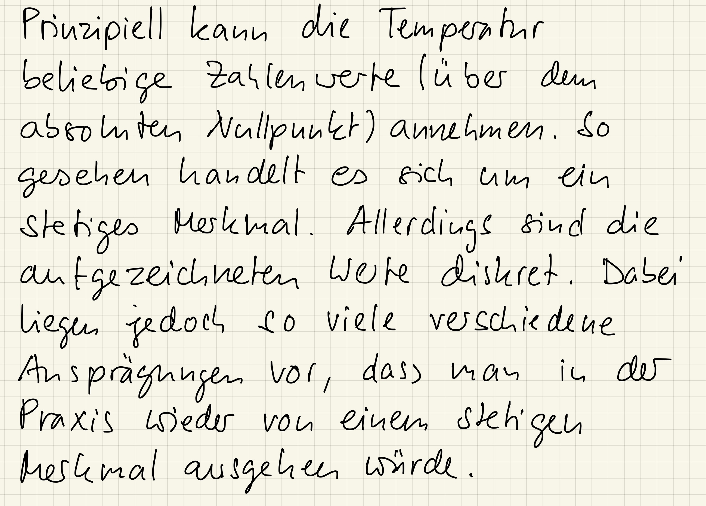

::: {#exr-temperaturaufzeichnung}
## Temperaturaufzeichnung

In einer Temperaturaufzeichnung werden die Werte als Zahlen mit einer Nachkommastelle aufgezeichnet. Handelt es sich um ein diskretes oder um ein stetiges Merkmal?

::: {.tinh-solution}

:::
:::
