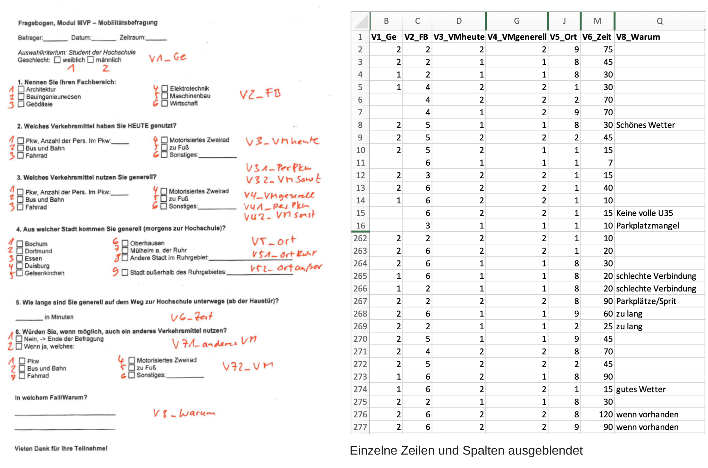
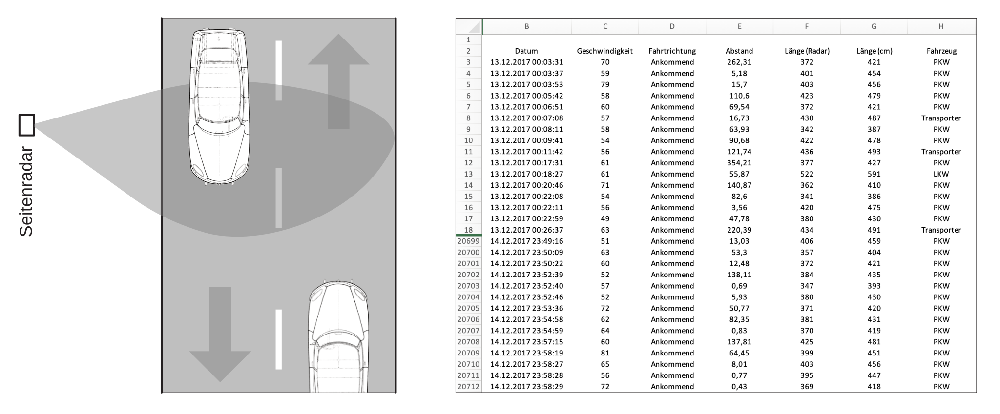
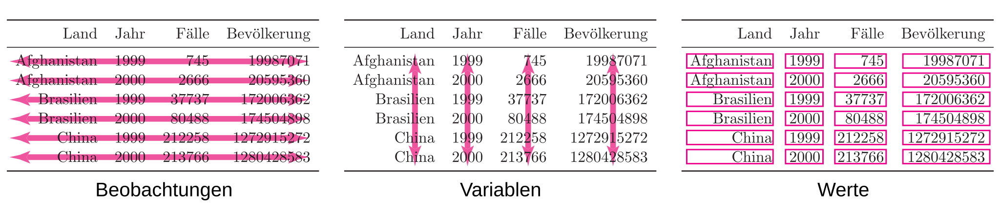

```{r}
#| include: false
source(rprojroot::is_quarto_project$find_file("_bcd-setup.R"))
# Daten und Hilfsfunktionen aus dem Skript
withr::with_dir("../skript", source("01-daten/statistische-daten.R"))
```

# Datenquellen

## Gewinnung von Rohdaten

Grundlage jeder statistischen Untersuchung sind Daten, zum Beispiel aus

- Umfragen: Wen würden Sie wählen, wenn am Sonntag Bundestagswahl wäre?
- Zählungen: Wie viele Menschen steigen an der Haltestelle Lennershof aus der U35?
- Messungen: Lufttemperatur und Luftdruck zu bestimmten Zeitpunkten
- Versuchsreihen: Wie hoch ist die Bruchfestigkeit von Betonwürfeln?
- Auswertungen protokollierter Daten: Suchwörter auf Google

## Datenquellen im Internet

- Ministerien ([BMV](https://bmv.de/SharedDocs/DE/Artikel/G/verkehr-in-zahlen.html),
  [BMWE](https://www.bundeswirtschaftsministerium.de/Navigation/DE/Themen/themen.html?cl2Categories_LeadKeyword=energiedaten-und-szenarien))
  und Bundesbehörden ([BASt](https://www.bast.de), [Statistisches Bundesamt](https://www.destatis.de))
- Berichte der Vereinten Nationen über die menschliche Entwicklung (*Human Development Reports*)
  <https://hdr.undp.org>
- Wetterdaten des [Deutschen Wetterdienstes](https://www.dwd.de/DE/klimaumwelt/cdc/cdc_node.html)
- Weltweite Wetterdaten der *National Oceanic and Atmospheric Administration*
  <https://www.ncdc.noaa.gov/cdo-web/datasets>

## Mobilitätsbefragung – Wege zur BO

- Befragung unter Angehörigen der BO im Modul „Methoden der Verkehrsplanung“ (Prof. Mühlenbruch)
- Von wo und mit welchen Verkehrsmitteln kommen die Befragten zur Hochschule?
- Knapp 300 Fragebögen, Antworten zur einfacheren Übertragung mit Ziffern codiert

{fig-align="center" height="55%"}

## Geschwindigkeitsmessung Universitätsstraße

- Seitenradar misst Geschwindigkeit und Länge vorbeifahrender Fahrzeuge
- Messung über zwei Tage im Jahr 2017 (Prof. Mühlenbruch)
- Daten werden aus dem Messgerät ausgelesen und als Excel-Datei gespeichert

{fig-align="center" height="55%"}

## Abfluss der Donau bei Hofkirchen

```{r}
ggplot(data = d_donau) +
  geom_point(
    mapping = aes(x = Datum, y = Abfluss, color = Abfluss),
    alpha = 1 / 5,
    show.legend = FALSE,
    size = 0.1
  ) +
  scale_colour_gradientn(colours = terrain.colors(10)) +
  labs(x = NULL, y = "Abfluss in m³/s")
```

- Ein Wert pro Tag von 1900 bis 2013, gut 40 000 Werte (Quelle: GRDC)
- Textdatei, Werte durch Semikolons getrennt (CSV-Datei)

# Organisation von Datensätzen

## Beispiel: Krankheitsfälle in drei Ländern

Fiktiver Datensatz zu Bevölkerung und Krankheitsfällen in drei Ländern für 1999 und 2000 (nach Wickham und Grolemund,
*R for Data Science*). Wie lassen sich die Daten in Tabellen anordnen?

## Lösung 1: Eine Spalte mit Beschreibung, eine mit Werten

```{r}
d_tidydata_1 |> tab_tidydata()
```

## Lösung 2: Eine Spalte für jede Variable

```{r}
d_tidydata_2 |> tab_tidydata()
```

## Lösung 3: Kombination von Werten

```{r}
d_tidydata_3 |> tab_tidydata()
```

## Lösung 4: Je eine Tabelle für Fälle und Bevölkerung

```{r}
d_tidydata_41 |>
  tab_tidydata() |>
  group_tt(j = list("Fälle" = 2:3))
```

```{r}
d_tidydata_42 |>
  tab_tidydata() |>
  group_tt(j = list("Bevölkerung" = 2:3))
```

## Zielführende Organisation

{fig-align="center" height="40%"}

1. Jede Variable erhält eine eigene Spalte.
1. Jede Beobachtung entspricht einer Zeile.
1. Jeder Wert steht in einer eigenen Zelle.

. . .

→ Lösung 2 entspricht diesem Schema

# Statistische Grundbegriffe

## Statistische Einheit

Objekte, an denen Daten beobachtet werden, heißen [statistische Einheiten]{.neuerbegriff}, zum Beispiel

- Person in der Mobilitätsbefragung
- Fahrzeug, das am Seitenradar vorbeifährt

. . .

Nicht immer eindeutig:

- Fahrzeug fährt im Messzeitraum zweimal am Seitenradar vorbei?
- Abflussmessung: Es geht immer um dieselbe Donau bei Hofkirchen

→ Den Begriff Beobachtung können wir immer verwenden

## Grundgesamtheit

Die [Grundgesamtheit]{.neuerbegriff} ist die Menge aller statistischen Einheiten, über die man Aussagen treffen möchte.

- Mobilitätsbefragung: alle Angehörigen der BO, endlich und bekannt
- Geschwindigkeitsmessung: lässt sich beliebig fortsetzen, unendlich groß
- Abschlussnoten der Absolvent:innen des Bauingenieurwesens im Jahr 2095: hypothetisch

## Stichprobe

Meist untersucht man nur einen Teil der Grundgesamtheit, eine [Stichprobe]{.neuerbegriff}.

```{r}
fig_stichprobe()
```

## Planung einer Erhebung

- Welche der beiden Stichproben eignet sich für Aussagen über die Verteilung der Farben? Wie groß ist groß
  genug?

  → Schließende Statistik

. . .

- Die Auswahl darf nicht systematisch bestimmte Einheiten bevorzugen. Am einfachsten: Jede Einheit kommt mit
  gleicher Wahrscheinlichkeit in die Stichprobe.

  → Befragung zur Mobilität auf dem Bahnsteig der U35?

. . .

- Für die Berechnung im Computer spielen diese Fragen keine Rolle, für die Interpretation sehr wohl

## Merkmale

- Eine Größe, für die man sich interessiert, heißt [Merkmal]{.neuerbegriff} oder [Variable]{.neuerbegriff}
- Meist werden für jede statistische Einheit mehrere Merkmale erhoben
- Die Werte eines Merkmals heißen [Merkmalsausprägungen]{.neuerbegriff} oder kurz [Ausprägungen]{.neuerbegriff}

## Zusammenfassung

Statistische Einheit:

: Objekt, an dem interessierende Größen erfasst werden

Grundgesamtheit:

: Menge aller für die Fragestellung relevanten statistischen Einheiten

Stichprobe:

: Tatsächlich untersuchte Teilmenge der Grundgesamtheit

Merkmal:

: Interessierende Größe, Variable

Merkmalsausprägung:

: Konkreter Wert für eine bestimmte statistische Einheit

# Typen von Merkmalen

## Drei Fragen

(a) Ist ein Merkmal stetig oder diskret?

(b) Auf welcher Skala wird ein Merkmal gemessen?

(c) Beschreibt das Merkmal eine Qualität oder eine Größe, die in Zahlen messbar ist?

. . .

→ Keine mathematischen Definitionen, sondern eine Orientierungshilfe

## (a) Diskrete und stetige Merkmale

- **Diskret:** endlich viele oder abzählbar unendlich viele mögliche Ausprägungen
- **Stetig:** alle Werte eines Intervalls möglich

Stetig sind in der Regel nur Merkmale, die sinnvollerweise durch reelle Zahlen repräsentiert werden.

. . .

In der Praxis werden stetige Merkmale gerundet erfasst, zum Beispiel die Körpergröße in ganzen Zentimetern.

→ Das Merkmal ist stetig, die Daten sind diskret

## (b) Skalenniveaus

1. **Nominalskala:** Ausprägungen sind Namen oder Kategorien, keine natürliche Rangfolge
1. **Ordinalskala:** natürliche Ordnung, Abstände nicht sinnvoll
1. **Intervallskala:** Zahlen, Differenzen sinnvoll, kein natürlicher Nullpunkt
1. **Verhältnisskala:** wie Intervallskala, aber mit natürlichem Nullpunkt

Intervall- und Verhältnisskala heißen zusammen [Kardinalskala]{.neuerbegriff} oder [metrische Skala]{.neuerbegriff}.

## Intervall- oder Verhältnisskala?

Temperatur in Grad Celsius ist intervallskaliert:

> „Gestern Mittag waren es 10 °C, heute sind es 20 °C. Es ist also doppelt so warm.“

→ nicht sinnvoll

. . .

Geschwindigkeit ist verhältnisskaliert:

> „Mein Porsche fährt mehr als doppelt so schnell wie dein Smart.“

→ sinnvoll

## Sinnvolle Operationen

| Skalenniveau    | auszählen | ordnen    | Differenzen bilden | Quotienten bilden |
|:---------------:|:---------:|:---------:|:------------------:|:-----------------:|
| Nominalskala    |  []{.ja}  | []{.nein} |     []{.nein}      |     []{.nein}     |
| Ordinalskala    |  []{.ja}  |  []{.ja}  |     []{.nein}      |     []{.nein}     |
| Intervallskala  |  []{.ja}  |  []{.ja}  |      []{.ja}       |     []{.nein}     |
| Verhältnisskala |  []{.ja}  |  []{.ja}  |      []{.ja}       |      []{.ja}      |

## (c) Qualitative und quantitative Merkmale

- **Qualitativ:** endlich viele Ausprägungen, nominal- oder ordinalskaliert; Ausprägungen entsprechen einer
  Qualität oder Kategorie
- **Quantitativ:** auf einer Intervall- oder Verhältnisskala messbar; Ausprägung ist eine Zahl, die eine Menge,
  Intensität oder ein Ausmaß wiedergibt

## Zusammenfassung

Diskret:

: Endlich oder abzählbar unendlich viele Ausprägungen

Stetig:

: Alle Werte eines Intervalls, Werte sind reelle Zahlen

Nominalskaliert:

: Ausprägungen sind Namen, keine Reihenfolge

Ordinalskaliert:

: Ausprägungen lassen sich ordnen, Abstände nicht interpretierbar

Intervallskaliert:

: Ausprägungen sind Zahlen, Abstände sinnvoll interpretierbar

Verhältnisskaliert:

: Wie intervallskaliert, aber mit natürlichem Nullpunkt

Qualitativ:

: Endlich viele Ausprägungen, nominal- oder ordinalskaliert

Quantitativ:

: Als Zahlenwert messbar
