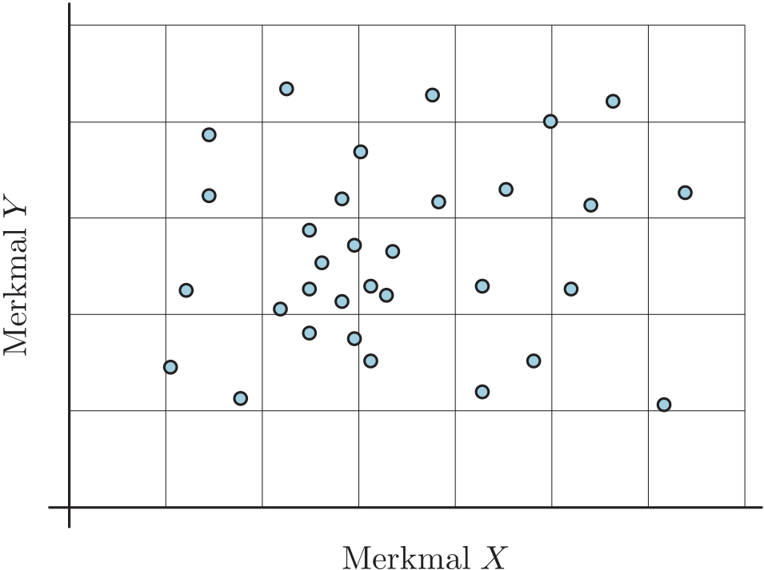
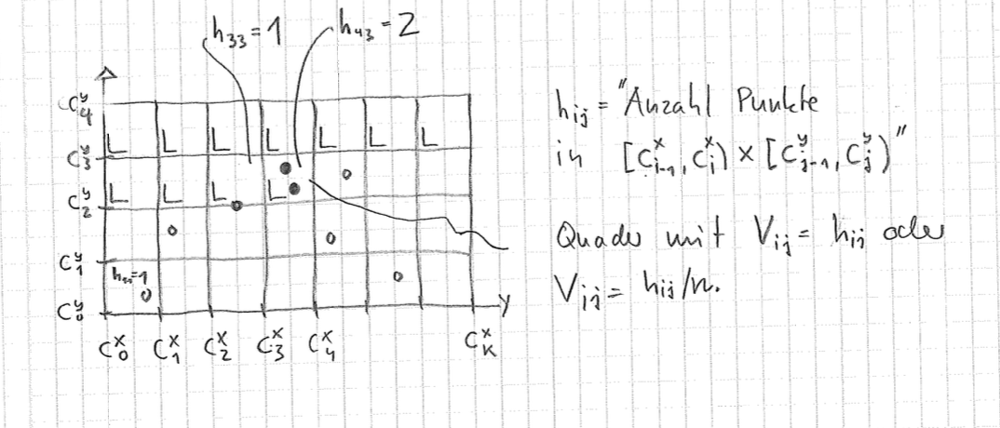

::: {#exr-histogramm-fuer-zwei-merkmale}
## Histogramm für zwei Merkmale

Übertragen Sie die Idee des Histogramms für eine Variable auf die unten dargestellte Situation mit zwei Merkmalen.

{width=50% fig-align="center"}

::: {.lm-solution}

:::
:::
