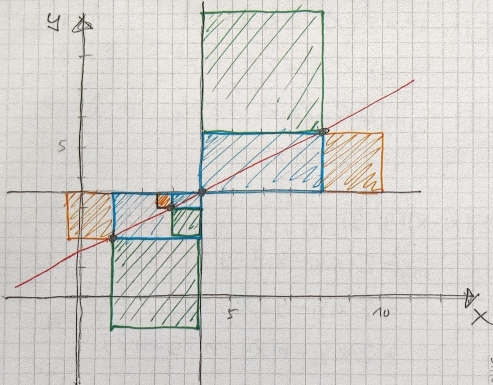

::: {#exr-korrelationskoeffizient}
## Korrelationskoeffizient

Bestimmen Sie für die Merkmale $X$ und $Y$ mit den Werten

|     | 1   | 2   | 3   | 4   |
|-----|-----|-----|-----|-----|
| X   | 1.0 | 3.0 | 4.0 | 8.0 |
| Y   | 2.0 | 3.0 | 3.5 | 5.5 |

den Korrelationskoeffizienten $r$. Verwenden Sie hierzu eine Skizze.

::: {.tinh-solution}
Skizze

Summe blau = $\frac{9}{2} + \frac{1}{2} + 8 = 13$

Summe grün = $1 + 9 + 16 = 26$

Summe gelb = $\frac{9}{4} + \frac{1}{4} + 4 = \frac{13}{2}$

Korrelationskoeffizient r = $\frac{13}{\sqrt{26 * \frac{13}{2}}} = \frac{13}{\sqrt{13 * 13}} = \frac{13}{13}  = 1$
:::
:::
