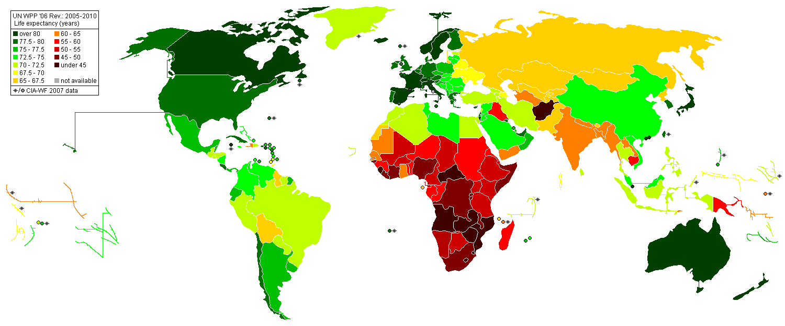
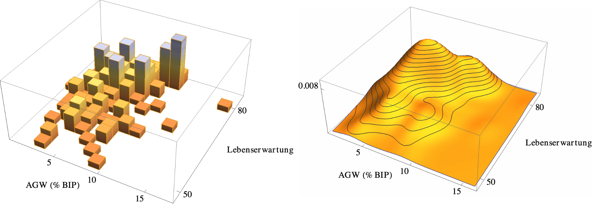
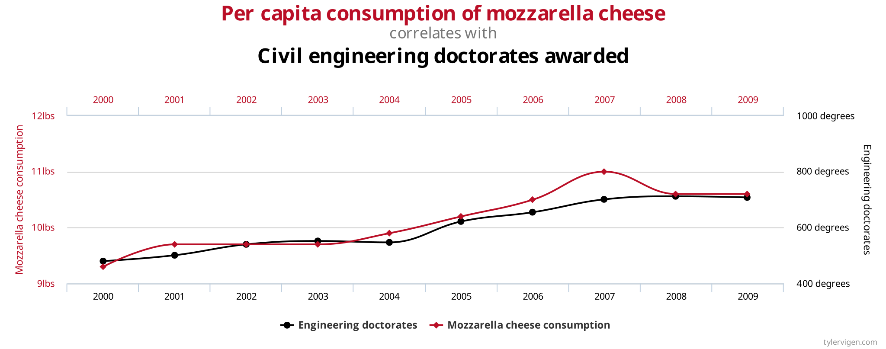
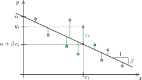

```{r}
#| cache: false
#| include: false
source(rprojroot::has_file("_bcd-setup.R")$find_file("_bcd-setup.R"))
withr::with_dir("../skript", source("01-daten/zwei-merkmale.R"))
```

## Inhalt

[]{.down50}

[]{.inhalt}

# Beispieldaten

## Prognose des Sachverständigenrats (Wirtschaftsweise)

{height="40%"}
{height="40%"}

```{r}
d_wirtschaftswachstum |> filter(Jahr < 1987) |> transpose_df(col = "Jahr") |> rename(Jahr = name) |> tt() |> style_tt(align = "c")
```

```{r}
d_wirtschaftswachstum |> filter(Jahr >= 1987) |> transpose_df(col = "Jahr") |> rename(Jahr = name) |> tt() |> style_tt(align = "c")
```

Quellen: Bundesarchiv und <https://www.sachverstaendigenrat-wirtschaft.de>

## Mittlere Lebenserwartung

{width=65%}

Wir untersuchen den Zusammenhang mit

::: {.columns}
::: {.column}
- BIP pro Kopf

- Ausgaben Gesundheitswesen (% BIP)
:::
::: {.column}
- Ausgaben Bildung (% BIP)

- Gini-Koeffizient des Einkommens
:::
:::

Quellen: Wikipedia und Weltbank

## PISA-Studie der OECD 2015

[]{.down40}

::: {.columns}
::: {.column width=20%}
{}
:::
::: {.column width=75%}
- Untersuchung von Schulleistungen in 73 Ländern

- Erhebung in den Bereichen 
  - Lesekompetenz
  - Mathematik
  - Naturwissenschaften

- Rohdaten: 519334 Beobachtungen von 921 Merkmalen

- Wir betrachten Mittelwerte der Länder
:::
:::

# Streudiagramm

## Streudiagramm und Blasendiagramm

[]{.down50}

::: {#def-streudiagramm}
Die Darstellung der Wertepaare $(x_1, y_1), (x_2, y_2), \dots, (x_n, y_n)$ durch geometrische Objekte (Punkte, Kreise) in einem $xy$-Koordinatensystem heißt [Streudiagramm]{.neuerbegriff}. Werden die Symbole nach einem dritten Merkmal skaliert, dann spricht man von einem [Blasendiagramm]{.neuerbegriff}.
:::

##

[]{.up40}

::: {#exm-sachverstaendigenrat}
## Prognosen des Sachverständigenrats

[]{.up10}

```{r}
#| fig-asp: 0.45
p_sachverstaendigenrat()
```

- 'Alle Prognosen richtig' $\iff$ 'Punkte auf der Winkelhalbierenden'
- Einzelne Werte an den Achsen durch Striche gekennzeichnet
:::

##

[]{.up40}

::: {#exm-lebenserwartung}
## Mittlere Lebenserwartung

[]{.up10}

```{r}
#| fig-asp: 0.5
#| fig-width: 12
p_lebenserwartung()
```

- BIP pro Kopf in logarithmischer Skala aufgetragen
:::

##

[]{.up40}

::: {#exm-blasendiagramm}
## Mittlere Lebenserwartung als Blasendiagramm

[]{.up10}

```{r}
p_blasendiagramm()
```

- Kreise nach BIP pro Kopf skaliert und eingefärbt
:::

# Zweidimensionale Histogramme und Dichten

## Zweidimensionales Histogramm

[]{.down20}

1. Klassen für die einzelnen Merkmale $X$ und $Y$
$$
[c^x_0, c^x_1), [c^x_1, c^x_2), \dots, [c^x_{k-1}, c^x_k)
\quad \text{und} \quad
[c^y_0, c^y_1), [c^y_1, c^y_2), \dots, [c^y_{m-1}, c^y_m)
$$

2. Rechtecke $[c^x_{i-1}, c^x_{i}) \times [c^y_{j-1}, c^y_{j})$ definieren die Klassen

3. Häufigkeiten
$$
h_{ij} = \text{Anzahl Punkte in } [c^x_{i-1}, c^x_{i}) \times [c^y_{j-1}, c^y_{j})
$$

4. Quader über jedem Rechteck anordnen mit dem Volumen
$$
V_{ij} = h_{ij} \quad \text{oder} \quad V_{ij} = h_{ij}/n
$$

## Kerndichteschätzer

[]{.down50}

Funktioniert im Prinzip genau wie für ein Merkmal. Unterschied: Produkt von zwei Kernfunktionen
$$
\hat f(x, y)
=
\frac{1}{n \, h_1 h_2}
\;
\sum_{i=1}^n
K\left(\frac{x-x_i}{h_1}\right)
K\left(\frac{y-y_i}{h_2}\right)
$$

[]{.down20}

Glättungseigenschaften hängen von den Parametern $h_1$ und $h_2$ sowie der Wahl der Kernfunktion $K$ ab

## Ausgaben Gesundheitswesen und Lebenserwartung

```{r}
#| fig-asp: 0.45
p_histogramm_dichte_2d()
```

- Links Histogramm, rechts Kerndichteschätzer

- Häufigkeiten bzw. Dichte farblich kodiert

## Ausgaben Gesundheitswesen und Lebenserwartung

{fig-align="center" height="65%"}

[]{.down10}

- Räumliche Darstellung von Histogramm und Kerndichteschätzer (Mathematica)

# Korrelationskoeffizient

## Zahl r mit −1 ≤ r ≤ 1

```{r}
#| fig-asp: 0.6
#| warning: false
p_korrelation_beispiele(farbig = FALSE)
```

## Zahl r mit −1 ≤ r ≤ 1

```{r}
#| fig-asp: 0.6
#| warning: false
p_korrelation_beispiele()
```

## Berechnung des Korrelationskoeffizienten

```{r}
#| cache: false
p_correlation_idea()
```

$$
r = \frac
{\text{Summe der blauen und roten Flächen}}
{\sqrt{(\text{Summe der gelben Flächen}) \cdot (\text{Summe der grünen Flächen})}}
$$

## Bravais-Pearson-Korrelationskoeffizient

[]{.down50}

::: {#def-korrelationskoeffizient}
Für die Werte $(x_i, y_i), i = 1, \dots, n$ heißt die Zahl
$$
r = \frac{
\displaystyle \sum_{i=1}^n (x_i - \bar{x})\cdot(y_i - \bar{y})
}{
\displaystyle \sqrt{\sum_{i=1}^n (x_i - \bar{x})^2} \cdot \sqrt{\sum_{i=1}^n (y_i - \bar{y})^2}
}
$$
[Bravais-Pearson-Korrelationskoeffizient]{.neuerbegriff}. Der Wertebereich ist $-1 \leq r \leq 1$.
:::

## Interpretation des Korrelationskoeffizienten

- $r > 0$: Positive Korrelation, Werte liegen tendenziell um eine Gerade positiver Steigung

- $r < 0$: Negative Korrelation, Werte liegen tendenziell um eine Gerade negativer Steigung

### Korrelationsgrad

- $r \approx 0$: Unkorreliert, kein linearer Zusammenhang

- $|r| < 0.5$: Schwache Korrelation

- $0.5 \leq |r| < 0.8$: Mittlere Korrelation

- $0.8 \leq |r| < 1$: Starke Korrelation

- $|r| = 1$: Die Werte liegen exakt auf einer Geraden

## Naheliegende Vermutung

[]{.down50}

$$
\text{Hohe Korrelation} \quad = \quad \text{Kausaler Zusammenhang}
$$

## Korrelation und Kausalität

{width="65%"}

Quelle: <http://tylervigen.com>

- Mozzarella-Konsum und Promotionen im Bauingenieurwesen (USA) mit $r = 0.96$ hochgradig korreliert

- Es besteht (wahrscheinlich) keinerlei Zusammenhang

## Korrelation und Kausalität

[]{.down50}

$$
\text{Korrelation} \quad \neq \quad \text{Kausalität}
$$

##

[]{.up40}

::: {#exm-scheinkorrelation}
## Scheinkorrelation in der PISA-Studie

[]{.up10}

```{r}
#| fig-asp: 0.4
p_pisa()
```

- Lesekompetenz und mathematische Kompetenz: $r = 0.94$

- Gut Lesen → Gut Rechnen?

- Wirklicher Zusammenhang: Gute Schulen → Gut Lesen und Rechnen
:::

# Lineare Regression

## Regression

[]{.down20}

Vermutung, dass zwischen zwei Merkmalen ein Zusammenhang besteht
$$
Y = f(X) + \varepsilon
$$

- Funktion $f$ erklärt einen Teil der Variabilität der Daten (Regressionsmodell)

- Größe $\varepsilon$ beinhaltet verbleibende zufällige Komponente der Variabilität

[]{.down20}

### Einfachste Möglichkeit: Lineare Regression

Es wird ein linearer Zusammenhang zwischen $X$ und $Y$ unterstellt
$$
f(x) = \alpha + \beta x
$$
Die Gerade heißt auch Ausgleichsgerade oder linearer Trend (Excel)

## Ausgleichsgerade

{fig-align="center" height="50%"}

Für die Datenpaare gilt
$$
y_i = \alpha + \beta x_i + \varepsilon_i
$$

Wie sollen $\alpha$ und $\beta$ gewählt werden?

## Methode der kleinsten Quadrate

[]{.down20}

Summe der Abstandsquadrate soll möglichst klein werden
$$
Q(\alpha, \beta) = \sum_{i=1}^n \varepsilon_i^2 = \sum_{i=1}^n (y_i - (\alpha + \beta x_i))^2
$$

Im Minimum sind die partiellen Ableitungen gleich null
$$
\frac{\partial Q(\alpha, \beta)}{\partial \alpha} = 0
\quad \text{und} \quad
\frac{\partial Q(\alpha, \beta)}{\partial \beta} = 0
$$

[]{.down20}

→ Tafel

## Lineare Regression

[]{.down20}

::: {#def-lineare-regression}
Für die Werte $(x_1, y_1), (x_2, y_2), \dots, (x_n, y_n)$ heißt der Zusammenhang
$$
y_i = \alpha + \beta x_i + \varepsilon_i
$$
[lineare Einfachregression]{.neuerbegriff}. Dabei ist $\alpha$ der $y$-Achsenabschnitt, $\beta$ die Steigung und $\varepsilon_i$ der Fehler.

Die [Kleinste-Quadrate-Schätzer]{.neuerbegriff}
$$
\hat \alpha = \bar{y} - \hat \beta \bar{x}
\quad \text{und} \quad
\hat \beta
=
\frac{
\displaystyle \sum_{i=1}^n(x_i - \bar{x})(y_i - \bar{y})
}{
\displaystyle \sum_{i=1}^n(x_i - \bar{x})^2
}
$$
minimieren die Summe der Fehlerquadrate.
:::

##

[]{.up40}

::: {#exm-pisa-studie}
## PISA-Studie

[]{.up10}

```{r}
#| fig-asp: 0.4
p_pisa_regression()
```

Lesekompetenz $X$ und mathematische Kompetenz $Y$
$$
\bar{x} = 461.8, \quad \bar{y} = 463.0
\quad \Rightarrow \quad
\hat \alpha = 58.9, \quad \hat \beta = 0.875
$$
:::

## Anscombes Quartett (F. Anscombe, 1973)

```{r}
#| fig-asp: 0.25
#| out-width: 50%
anscombe |> plot_anscombe(c(3, 15))
```

Vier Datensätze mit derselben Ausgleichsgeraden. Wo ist die Ausgleichsgerade sinnvoll?

. . .

1. Linearer Zusammenhang mit zufälliger Abweichung, Ausgleichsgerade sinnvoll

2. Zusammenhang quadratisch, Ausgleichsgerade sinnlos

3. Ausgleichsgerade durch Ausreißer verfälscht

4. Ohne Ausreißer keine Ausgleichsgerade

. . .

→ Im Zweifelsfall immer die Daten anschauen!

## Bestimmtheitsmaß

::: {#def-bestimmtheitsmass}
Für die Werte $(x_1, y_1), (x_2, y_2), \dots, (x_n, y_n)$ erfasst das [Bestimmtheitsmaß]{.neuerbegriff}
$$
R^2
\; = \;
\frac{\text{Streuung Ausgleichsgerade}}{\text{Gesamte Streuung}}
\; = \;
\frac{
\displaystyle \sum_{i=1}^n(\hat y_i - \bar{y})^2
}{
\displaystyle \sum_{i=1}^n(y_i - \bar{y})^2
}
\quad \text{mit} \quad
\hat y_i = \hat \alpha + \hat \beta x_i
$$
mit $0 \leq R^2 \leq 1$ die Güte des linearen Modells. Es gilt $R^2 = r^2$.
:::

. . .

[]{.down20}

Neue Interpretation des Korrelationskoeffizienten: $r^2$ ist der Anteil der Streuung, der durch das lineare Modell erklärt wird

##

[]{.up40}

::: {#exm-bestimmtheitsmass}
## Bestimmtheitsmaß

[]{.up10}

```{r}
#| fig-asp: 0.4
#| out-width: 80%
#| fig-align: center
p_bestimmtheitsmass_beispiel()
```

- Links $R^2 = `r round(summary(lm(y1 ~ x, data = d_rsquare_example))$r.squared, 2)`$, rechts $R^2 = `r round(summary(lm(y2 ~ x, data = d_rsquare_example))$r.squared, 2)`$

- Unterschiedliche Variabilität um die Ausgleichsgerade wird gut erfasst
:::

##

[]{.up40}

::: {#exm-anscombe-residuen}
## Anscombes Quartett: Residuen

[]{.up10}

```{r}
#| fig-asp: 0.25
p_anscombe_residuen()
```

- Bestimmtheitsmaß in allen vier Fällen $R^2 = 0.67$

- Gibt keinen Aufschluss darüber, ob das lineare Modell sinnvoll ist

- Im Zweifelsfall die Residuen $\varepsilon_i$ plotten
:::

## Nichtlineare und lokale Regression

::: {.columns}
::: {.column width=45%}
Quadratisches Modell
$$
Y = \alpha + \beta X + \gamma X^2 + \varepsilon
$$

Exponentieller Ansatz
$$
Y = \alpha \exp(\beta X) + \varepsilon
$$

Lokale Regression mit der LOESS-Methode (*Locally Estimated Scatterplot Smoothing*)
:::
::: {.column width=50%}
```{r}
#| fig-asp: 0.7
#| out-width: 100%
p_loess()
```

Werte variieren um eine Sinusfunktion, die LOESS-Kurve bildet den Zusammenhang sehr gut ab
:::
:::

# Mit den Beispieldaten

## Prognose Sachverständigenrat

```{r}
#| fig-asp: 0.45
plot_linear_regression(d_wirtschaftswachstum, Prognose, Wachstum, "Prognose", "Wachstum")
```

- Mittlere Korrelation mit $r = 0.64$

- 40 % der Variabilität des Wachstums durch das lineare Modell erklärt

## Mittlere Lebenserwartung

::: {.columns}
::: {.column width=60%}
```{r}
#| fig-asp: 0.8
#| out-width: 100%
p_regression_lebenserwartung()
```
:::
::: {.column width=35%}
[]{.down50}

- Schwache Korrelation für Ausgaben Gesundheitswesen, Bildung und Gini-Koeffizient

- Starke Korrelation für BIP pro Kopf (logarithmisch)
:::
:::
